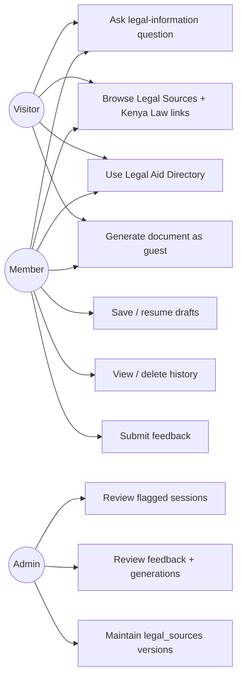
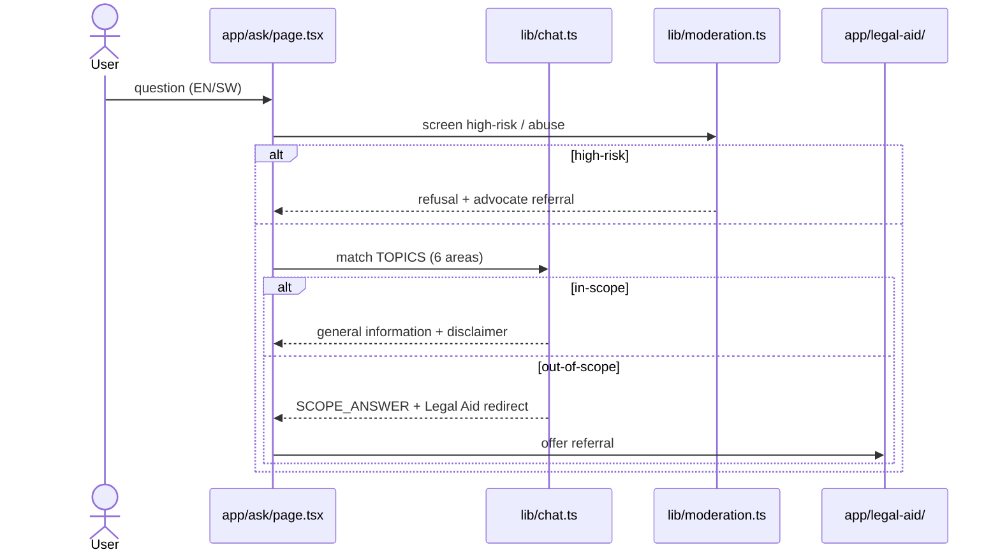
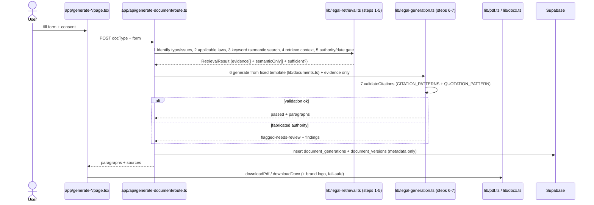
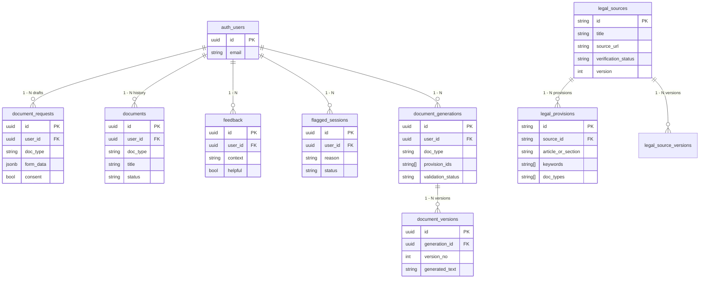

# HAKI AI — Chapter Two: Design & Modelling (DSE 315 Milestone M2)

> Reverse-engineered FROM the shipped UI (`app/`), pipeline (`lib/legal-retrieval.ts`, `lib/legal-generation.ts`), and schema (`supabase/schema.sql`). Draw.io / dbdiagram.io versions can be traced 1:1 from the Mermaid below.

## 2.1 Use-Case Diagram (Actors: Visitor, Member, Admin)

Evidence: `app/ask`, `app/legal-sources`, `app/legal-aid`, `app/generate-*/`, `app/dashboard` (drafts/history/feedback), `app/admin` (flagged_sessions), RLS admin = `michaelkariuki281@gmail.com` (`supabase/schema.sql`).

## 2.2 Sequence — Ask flow (scoped)

Evidence: `lib/chat.ts: TOPICS`, `SCOPE_ANSWER` (six areas: Tenant, Employment, Consumer, Debt, Business Agreements, Complaint Letters); `lib/i18n.ts` scope disclaimer; `lib/moderation.ts`.

## 2.3 Sequence — Generate flow (steps 1–7)

Evidence: `lib/legal-retrieval.ts:1-15` (steps 1–5 comments), `lib/legal-generation.ts:1-16` (steps 6–7), `lib/documents.ts: buildParagraphsForDoc`, `scripts/test-grounding.ts` (retrieval sufficient, citation validation, fabricated Section 99 / invented case law rejected).

## 2.4 ERD (from `supabase/schema.sql` FKs)

RLS: drafts/documents/generations owner-only; `legal_sources`/`legal_provisions` public read + admin write; `flagged_sessions`/`feedback` admin select (`supabase/schema.sql:60-99`, `167-204`).

## 2.5 UI Wireframes (traced from live pages — screenshot then box-trace in draw.io)

1. **Home (`/`)**: header (logo `public/logo-icon.jpg` + EN/SW toggle + login) → hero (HAKI AI + disclaimer banner) → 6-area cards → 9-generator grid → Legal Aid CTA → footer (Gold #C9A227 Contact button).
2. **Ask (`/ask`)**: input box → scope-notice banner (`lib/i18n.ts`) → answer card (facts vs drafting vs authorities) → out-of-scope card with Legal Aid link → feedback thumbs.
3. **Generator form (`/generate-*`)**: title → form fields (sender/phone/recipient/issue/amount/…) → consent checkbox → Generate → preview (title + body + authorities + missing-info + advocate notes) → Download PDF / DOCX.
4. **PDF output**: centred logo (54pt, `lib/brand-logo.ts`) → TITLE → justified body (`lib/pdf.ts` TJ arrays) → authorities (Kenya Law URLs) → footer every page (template + disclaimer + page no.).
5. **Dashboard (`/dashboard`)**: drafts (save/resume per `user_id+doc_type` unique) → history (metadata only) → delete → feedback summary.

Flowcharts for draw.io: Ask flow = `lib/chat.ts` branch (in-scope / out-of-scope / high-risk); Generate flow = §2.3 steps 1–7.
